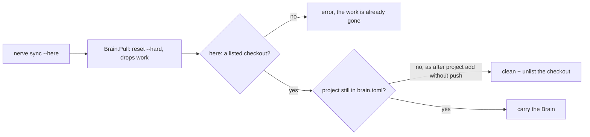

# Review of `feat/projects` at b3ccbcd

Review eight: the whole branch, after the explicit-verbs rework ([ADR 0009](docs/adr/0009-explicit-verbs.md)) and the fixes of review seven. main is a full rewrite away, so it was ignored.

## How it ran

- **Baseline, all green:**
  - `go test -race ./...` and `NERVE_OPEN_BUGS=1 go test ./...` pass. No test is skipped as an open bug.
  - `golangci-lint run` reports 0 issues, and `go vet` is clean.
- **Explore:** five Haiku explorers covered domain, app, infra (split in two), and cmd plus docs. They gave leads only.
- **Review:** five Sonnet reviewers, each in its own worktree on b3ccbcd (checked).
  - They confirmed or refuted every lead and hunted freely.
  - They used throwaway tests, and the built binary on a temp HOME with `GIT_CONFIG_GLOBAL=/dev/null` and no network.
- **Verify:** each finding below has one of these labels.
  - **Repro:** I reproduced it myself on a temp HOME.
  - **Code:** I confirmed it by reading the code.
  - **Code + reviewer:** I read the code, and the reviewer has a repro.
  - **Plausible:** reasoned, not reproduced.
- **Dropped:** anything refuted or unverified.

## Outcome

- No high-severity bug. Nothing writes outside what nerve owns: 11 link scenarios held.
- The core rules hold under heavy testing:
  - 50k random cases of Reconcile, Strip and PersonalKeys never lost a personal setting and never showed false drift.
  - 200k random keys round-tripped through ParseKey.
- The weak spot is sync's Brain reset (ADR 0009):
  - It runs before anything is checked.
  - nerve's own hint after `project add` leads into it.
  - Its report misses untracked files it overwrites.
- The other cluster is the shared `info/exclude` block, and the clean path when nerve's state is missing or the checkout moved.



## Bugs, by severity

### Medium

1. **Sync drops the Brain's work before it checks it can run.** Repro.
   - `app/sync.go:39` pulls first. The `--here` checkout is resolved only at `:61`.
   - From a folder that is not a listed checkout, or not a repo:
     ```
     pulled   the Brain to d3ddb54, dropping 1 local commit and changes to 1 file
     error: …/other is not a listed checkout: run nerve project add <name> in it
     ```
   - A mistyped `cd` loses unpushed work, and the command still fails.
   - Fix: resolve the checkout and load the machine file's view before `Brain.Pull`.

2. **`project add` tells the user to run the command that undoes it.** Repro.
   - `app/project.go:47` says `listed: review brain.toml, then nerve sync --here`. The new entry is an uncommitted change to `brain.toml`, so following the hint does this:
     ```
     pulled   the Brain to b5669f4, dropping changes to 1 file
     cleaned  …/proj: project app left the Brain
     unlisted …/proj, a checkout of app: project app left the Brain
     ```
   - The project is gone from the Brain, and the checkout is gone from the machine file.
   - The drop report never names the files it dropped (`infra/brain_checkout.go:320-327`), so the user cannot tell `brain.toml` was one.
   - This contradicts ADR 0009: sync brings the remote here, and push sends the Brain there.
   - Fix: the hint says `nerve push <message>`, then `nerve sync --here`. The drop report names a few files.

3. **A large float in `brain.toml` blocks every later write to the Brain.** Repro.
   - `nerve setting set cleanupPeriodDays 1e19` succeeds, and writes `cleanupPeriodDays = 1e+19`.
   - Every later command that saves the Brain then fails, while `check` says "no problems":
     ```
     error: brain.toml: project.app.settings.cleanupPeriodDays: settings cannot hold null, or a whole number beyond 64 bits
     ```
   - Cause:
     - `normalize` (`infra/brain_checkout.go:183-190`) round-trips through `json.Marshal`, which prints `1e19` as `10000000000000000000`.
     - `domain.Numbers` (`settings.go:661`) reads that back as a big `json.Number`.
   - Any float from 2^63 to 1e21 does it. The message also names a whole number the user never wrote.
   - Fix: convert the TOML tree directly, or make `Numbers` idempotent across encode and decode. The same fix covers low bug 13.

4. **Sync leaves a moved checkout of a dropped project half-cleaned, with nerve's links visible to git.** Repro.
   - `app/sync.go:73-82` calls `clean` without `adopt`. `project rm` adopts first (`app/project.go:134`).
   - Steps: move a synced checkout, then drop its project from the Brain on any machine, then run `nerve sync`.
   - Result:
     - The checkout's links, its settings and the SessionStart hook all stay.
     - The exclude block is removed, so `git status` shows `?? .claude/`.
     - The checkout is unlisted, so no later sync fixes it.
     - The run still prints `cleaned`.
   - This breaks sync.md: "a project dropped from the Brain … is cleaned out of its checkouts".
   - Fix: adopt by link target in the sync clean path, as `project rm` does. At least keep the block when nerve cannot tell what is its own.

5. **An unreadable state of one worktree drops its links from the shared exclude block.** Repro.
   - `Machine.States()` skips unreadable files (`infra/machine_files.go:242`). `app/sync.go:322` builds the repo's block from what is left.
   - Steps:
     - Worktrees `proj` (project p) and `wt` (project q, agent `rev`) share one repo.
     - Corrupt `wt`'s state file, then run `nerve sync --here` in `proj`.
   - Result: the block keeps only `/.claude/skills/nerve`. `git status` in `wt` shows `?? .claude/`, and `git add -A` would stage nerve's link.
   - A full sync heals it. `--here`, or a sync where `wt` fails, does not.
   - Fix: when a listed checkout of the repo has an unreadable state, keep the block's existing lines for it.

### Low

6. **Sync overwrites an untracked Brain file the remote now has, and does not say so.** Repro.
   - With an untracked `clash` ("mine") and a remote commit adding `clash`, the run printed only `pulled the Brain to cd20875`. The file now holds the remote's text.
   - sync.md documents the overwrite, but also says sync "says which local commits and changes it dropped".
   - Fix: count the untracked paths that `@{upstream}`'s tree holds, and report them.

7. **The session report writes the Brain's `.git/index`.** Repro.
   - `nerve status --hook` runs `git status --porcelain` (`infra/brain_checkout.go:420`). Git refreshes the index, which changed its mtime on each run.
   - It runs at every session start. It can collide with a `git commit` in the Brain on `index.lock`. It also goes against sync.md: "It changes nothing".
   - Fix: set `GIT_OPTIONAL_LOCKS=0` in `gitWithin`.

8. **`status` with an unreadable state calls nerve's own links "yours".** Repro.
   - `app/status.go:63-67`, then `othersItems` (`app/items.go:98`). The output reads `never synced`, `skill nerve yours` and `agent rev yours`.
   - The problem line also prints the state path twice.

9. **A full sync's text report does not say which checkout a line is about.** Repro for one checkout, Code + reviewer for three.
   - `drift`, `set`, `personal`, `synced` and `is up to date` carry no path in text (`app/events.go:70-84`). JSON has it.
   - The closing error says `drifted in 2 of 3 checkouts`, without naming them.

10. **`project rm` stops halfway, with an error that names no checkout.** Code + reviewer.
    - `app/project.go:114-124` returns `clean`'s error as it is. Example: `.claude is a link, so nerve would write outside the tree`.
    - The checkouts before the failing one are already cleaned. The project stays in the Brain, and every checkout stays listed.
    - Fix: check `throughLink` on every tree before cleaning any, and wrap errors with the path.

11. **`project rm` cannot run when `.claude` is a file.** Repro.
    - `readObject` (`infra/files.go:133-139`) treats only `ErrNotExist` as missing:
      ```
      error: open …/p3/.claude/settings.local.json: not a directory
      ```

12. **A Brain that is not a git repo is used in silence.** Repro.
    - `infra/brain_checkout.go:304` returns no event. Sync ends with `app is up to date at an uncommitted Brain`.
    - `init` accepts such a folder too, although its own error text says a Brain is a git repo. Only `push` refuses it.
    - sync.md's list of skips doesn't name this case.

13. **A number typed on the command line is not the number read back from a file.** Repro.
    - `setting add foo 1e19` run twice gives `[10000000000000000000, 10000000000000000000]`.
    - `setting rm foo=1e19` then says `no project app holds foo=1e19`.
    - Same cause as medium bug 3.

14. **The session report hides that the team owns a listed item.** Repro.
    - After the first sync, `status` shows `agent rev the team's`, but no problem.
    - The hook report says only `synced at …`, so the listed agent is silently missing.

15. **Effects reported wrong on a failure.** Code + reviewer.
    - `update` prints `pinned … then nerve push` before `Brain.Save` (`app/items.go:147`). On a failed save, the pin never happened.
    - Sync drops a gone checkout's state before `Machine.Save` (`app/sync.go:152`). On a failed save, the `unlisted` event is withheld once.
    - Folders sync makes (`.claude/skills`, `.claude/agents`) get no event, while `project rm` reports removing them.

16. **A broken overlay file blocks `project rm`, and half-fails `setting set`.** Code + reviewer.
    - `project rm` fails on the parse error, before cleaning anything.
    - `setting set` saves the Brain and prints `set`, then fails in `dropOverlaid`, with exit 1.
    - Neither message names the file to fix.

17. **Keys `setting set` should refuse.** Repro.
    - `setting set model=opus x` makes a literal key `"model=opus"`, which reaches `settings.local.json`.
    - `setting set '""' x` makes a key `""`.
    - Code + reviewer: a key holding `\x1f`, nerve's internal separator, collides with a nested key.

18. **What `check` lets through.** Code + reviewer.
    - An agent file whose name breaks the name pattern, such as `agents/Bad_Name.md`. `AgentProblem` (`domain/skill.go:177`) doesn't check it, and `offers` then refuses to list the agent.
    - A hook with `event = "Bogus"` or a matcher that is not a valid regex. Sync writes it into `settings.local.json`. Plausible: Claude Code may then reject the whole file, the session report included. Fact-check its hook events before coding a list.
    - Repeated entries in a project's lists, such as `skills = ["foo", "foo"]`. `status` then counts 2 skills.
    - A machine-file checkout with no `project`. Sync then prints `checkout …proj (): its project left the Brain`.

19. **Small things in the CLI.**
    - `nerve --project app status --hook` is not hook mode: the command word is the first word with no dash (`cmd/nerve/main.go:161-169`). Repro. The generated hook never uses this form.
    - `--project` with no name stays refused once seen, even if a name follows later (`main.go:117`).
    - An unknown `--flag` prints the usage with no reason (`main.go:110`). `-flag` gets one.
    - `nerve push add go-stack` prints the usage, with no hint to quote the message.
    - `nerve update` with no sources prints nothing.
    - `nerve push` with nothing to commit says `pushed the Brain at <sha>`.
    - `project add` inside the Brain checkout is accepted (Repro). The Brain then holds `.claude/` links, kept out of git.

### Hardening (take each, or add it to not-bugs.md)

- Pull ignores errors from `rev-list --count` and `status` (`infra/brain_checkout.go:322-325`), so a broken repo under-reports what it drops.
- `upstream()` turns any `git config` failure into "no upstream branch".
- A remote whose fetch refspec leaves out the upstream branch is reported as "not on the remote".
- No check for git 2.31: an older git shows a raw `rev-parse` error.
- `Locate` calls every `show-toplevel` failure "not in a git repo", a missing folder included.
- `push` with no git identity leaves the Brain's files staged, behind git's long message.
- The report drops its encoder's errors (`infra/report.go`), so a closed pipe exits 0.
- `shortenHome` leaves a folder named `..x` under HOME as an absolute path (`infra/files.go:234`).
- `findSkill`'s comment says a skill is in one place only, but a root `SKILL.md` wins over `skills/<name>/` (`infra/sources.go:177-184`). brain.md matches the code, so fix the comment.
- A non-object `settings.local.json` gives Go's `cannot unmarshal array into Go value of type map[string]interface {}`.
- Sync prints personal and drifted values in full, in text and in `--json`. Plausible risk in CI logs.

## Spec violations

- **GLOSSARY.md's _Avoid_ "pull" for Sync.** Code.
  - The event kinds `pulled` and `pull-skipped`, and their text `pulled   the Brain to …` and `no pull` (`app/events.go:36-37`, `:100-108`).
  - SKILL.md:72-73, the `Brain.Pull` port, and the error text `pull %s` (`infra/brain_checkout.go:330`).
  - CLAUDE.md says the code is renamed. Before 1.0 the event kinds can change with no shim.
- **ADR 0009 and sync.md "Makes the Brain its remote's"** against `project add`'s hint (medium bug 2).
- **sync.md "says which local commits and changes it dropped"** against untracked overwrites (low bug 6).
- **sync.md "It changes nothing"** for the session report, against the index refresh (low bug 7).
- **sync.md "A project dropped from the Brain … is cleaned out of its checkouts"**, not for a moved checkout (medium bug 4).
- **brain.md "refuses … whole numbers beyond 64 bits"** turns a float nerve wrote into a lock (medium bug 3).
- **brain.md "Skill, agent, hook and project names are lowercase words"**, not checked for agent files (low bug 18).
- **CLAUDE.md "Every effect is visible and reported"** against folders made, the pin reported before the save, and the state dropped before the save (low bug 15).

## Docs

- sync.md:50 says sync unlists a checkout that is gone. It also unlists one whose project left the Brain (SKILL.md:70 says so).
- `nerve sync --discard` without `--here` drops drift in every checkout. The usage and the drift error offer it, but sync.md and SKILL.md describe only `--here --discard`.
- `status` outside a listed checkout lists the projects. The usage line doesn't say so. SKILL.md does.
- ADR 0007's status line lost words: "…on a name the team has The `nerve` pin…". Status lines may be fixed.
- Stale words after ADR 0009: `sync_pulls_the_brain.txtar:1` says sync "fast-forwards" the Brain, and so does the test name `TestPullFastForwardsTheBrain`. It resets.
- Things the docs don't say:
  - Sync rewrites a personal `settings.local.json` in nerve's form: sorted keys, `1e3` as `1000`, floats past 17 digits rounded.
  - `config.toml` loses comments, and becomes 0600, when nerve saves it. brain.md says this of `brain.toml` only.
- SKILL.md names neither the `overlay` event nor the `error` field of a failed command's JSON.
- brain.md lists the allowed settings in full, against CLAUDE.md's "never list in full what the code lists". It matches the code today, and users need the list. Keep it, and add it to not-bugs.md.
- `review-feat-projects.md` is a tracked record that CLAUDE.md doesn't name beside `conversation-notes.md`.

## Tests

### Gaps on essential paths

- Sync's order: nothing tests that a sync which cannot run drops nothing (medium bug 1).
- `brain.toml` Save with a float from 2^63 to 1e21 (medium bug 3).
- Sync of a moved checkout whose project left the Brain (medium bug 4).
- A shared exclude block with one unreadable state (medium bug 5).
- `status --hook` leaving the Brain's `.git` untouched (low bug 7).
- `project rm` with several checkouts where a later one fails; a `.claude` that is a file.
- `status` with an unreadable state.
- Failing pushes: detached HEAD, rejected, no identity, a failing hook.
- Scripts:
  - nothing for push, or for sync's drop and skip reports;
  - no full `sync --discard`;
  - no `rm --all` for skill, agent or plugin.

### Weak tests

- `TestPullTakesTheRemotesFileOrFolderOverAnUntrackedOneInTheWay` (`infra/brain_checkout_test.go:432`) checks HEAD only. It would pass if the file were lost unreported.
- `TestPullDropsLocalCommitsAndChangesAndSaysSo` checks the count text only.
- `TestPersonalKeysNameAnItemApartFromAKeyLikeIt` (`domain/settings_test.go:332`) checks counts, not names.
- `TestSettingsKeepTheirTextAndEveryDigit` matches substrings, and has no float past 17 digits.
- `drift.txtar` checks that `Bash(make)` survives `--discard`, but `Bash(make)` is in the Brain by then. Nothing at the CLI shows that personal settings survive it (they do, checked by hand).
- `project_gets_what_it_lists.txtar` sets `permissions.deny` and never checks it.
- `json_report.txtar` matches lines; it doesn't check one valid document. 27 error paths checked by hand were.

### Fakes

- `fakeMachine.States` never skips an unreadable state, so medium bug 5 cannot show in app tests.
- `fakeTrees.SyncExclude` keys damage by checkout, not by repo.
- `fakeBrain.Pull` and `Push` emit nothing and refuse nothing, so no app test sees the drop report or the order of medium bug 1.
- `fakeBrain.Agents` never fails. The script tests cover `check`'s agent branch.
- `fakeSources.Head` returns `""` with no error for an unknown repo. The real adapter errors, and `update` was checked by hand.

## Ignored (not-bugs.md)

- A worktree of a bare repo is its own checkout. The exclude lock waits with no bound. Changes to the block aren't reported.
- After a move or an unreadable state, every setting as the Brain sets it is nerve's. `project rm` leaves an empty `.claude/skills` after a move.
- A link is removed, then made again.
- An existing `settings.local.json` keeps its mode (0444 stayed 0444). nerve makes `~/.config` 0700.
- `onMachine` ignores the machine file's load error. `check` needs HOME.
- `\0` and `\e` in frontmatter come out as written. An overlay cannot take an item out of a Brain list.
- A source is found in fixed places, its cache is never evicted, and a fetch checks out the whole repo.
- Some fakes never fail.

## Checked and fine

- **Links and writes:** 11 link scenarios (`.claude`, `skills`, `agents`, `settings.local.json`, team folders and files, a linked `info/` or `info/exclude`). Nothing was written outside the checkout, and only nerve's links were removed.
- **Settings rules:** drift, personal settings (reported once, kept through `--discard` and `project rm`), list items joined one by one, and `{}` left by `project rm`. Reproduced by hand: drift exits 1 with the right hint, and `--discard` keeps personal settings.
- **Sync of a Brain whose remote changed:** it reports dropped local commits, staged, unstaged, deleted and renamed files, and diverged history.
  - It skips, and says why, for no upstream, a detached HEAD, a remote it cannot reach, and a branch gone from the remote.
  - It keeps untracked files.
- **Push:** it refuses changes with no message and a disallowed setting. It pushes local commits with no message, and a message that starts with `-`. A failing pre-push hook leaves the commit for the next push.
- **Git env:** with `GIT_DIR`, `GIT_WORK_TREE` and `GIT_INDEX_FILE` set to a decoy repo, sync, status and push acted on the right repos.
- **Exclude block:** damage refused, CRLF kept, newline added, submodules and worktrees handled, lines merged across worktrees.
- **The session report:** it exits 0 with one `systemMessage` for a broken or missing machine file, `brain.toml` or Brain, an unreadable state, and no HOME. It writes nothing under HOME.
- **`--json`:** about 30 error paths, each one valid document on stdout, with an empty stderr and exit 1.
- **`brain.toml` round trip:** about 30 shapes, including arrays of tables, empty tables, quoted and dotted keys, NUL and U+2028, `{{brain}}`, int64 limits, 1e300, and BOM with CRLF. nan, inf, dates and big integers are refused clearly.
- **Machine file:** `~`, a trailing slash and a link count as the same checkout. Unknown keys and relative paths are refused. Files are 0600 in 0700 folders.
- **The README's usage lines**, run in order against a bare remote, each do what the README says. So does `update` (diff, then pin, then `already pinned`).
- **ADR 0009 and 0008:** `nerve` and `autosync` keys refused. `syncClaudeAiSkills` stays allowed on purpose (ADR 0008).
- **Hook command:** the binary's path is shell-quoted when needed.
- **Layers:** depguard matches CLAUDE.md. CI lints with golangci-lint v2.14.0, as development.md says.

## Fix order

1. **Sync drops nothing it shouldn't** (medium bugs 1 and 2, low bug 6, sync's half of low bug 12).
   - Resolve the checkout before `Brain.Pull`.
   - `project add` hints at `push`.
   - The drop report names files and counts untracked overwrites.
   - Not a repo means a `pull-skipped` event.
   - Write the failing tests first: sync's order in app with a fake `Pull` that records, and a script for `sync --here` outside a checkout.
2. **Numbers** (medium bug 3, low bug 13). Convert TOML without JSON, or make `Numbers` idempotent. Test that Save takes 1e19 and 1e20, and that `ParseValue` equals the value read back.
3. **Clean path and exclude block** (medium bugs 4 and 5, low bug 10, the stale lines of a gone worktree).
   - Adopt by link target in sync's clean.
   - Keep the block lines of an unreadable state.
   - Make the fakes skip unreadable states as the adapter does.
4. **`GIT_OPTIONAL_LOCKS=0`** in `gitWithin` (low bug 7), with a test that `status` leaves the index alone.
5. **Reports:** a path on per-checkout lines, status with an unreadable state, the team conflict in status, pins and drops after the save, and events for folders (low bugs 8, 9, 14 and 15).
6. **`project rm` robustness** (low bugs 10, 11 and 16): check every tree first, paths in errors, `ENOTDIR` as missing, and name the broken overlay.
7. **Validation** (low bugs 17 and 18, `init` of a folder that is not a repo, `project add` in the Brain). Fact-check Claude Code's hook events before listing them.
8. **Rename "pull"** in events, the port, SKILL.md and test names. It is breaking; before 1.0, with no shim.
9. **CLI nits** (low bug 19), the hardening list, and the docs and test items above.
